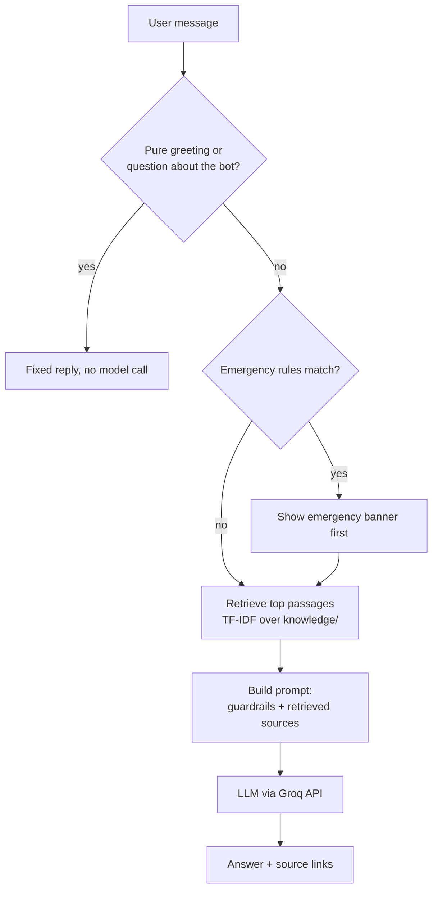

# 🩺 Health Assistant

A retrieval-augmented (RAG) chatbot that answers general health questions in plain language, grounded in curated WHO and MedlinePlus summaries, with a rule-based emergency layer and a built-in evaluation suite.

**Live demo:** `YOUR-APP-URL`

> ⚠️ **Not a medical device.** This project gives general health information only. It cannot diagnose, prescribe, or replace a doctor. In an emergency, call **112** (India) or your local emergency number.

---

## Features

- **Grounded answers (RAG):** retrieves the most relevant passages from a local knowledge base and passes them to the model, then lists the source links under the answer.
- **Emergency detection:** a rule-based layer (English, typos, and romanized Hindi) shows an emergency banner before the model answers. It does not depend on the model.
- **Guardrails:** the system prompt forbids diagnosis and numeric medicine doses, and requires a "when to see a doctor" referral for symptom questions.
- **Small talk handled in code:** greetings, thanks, "who are you", "what can you do", and similar questions get instant fixed replies (typo-tolerant), so they never reach the model.
- **Evaluation harness:** repeatable test suites for emergency detection, retrieval, and model behavior, with a results report.
- **Clean chat interface:** custom HTML/CSS front end on Streamlit; the start screen shows example questions, and during a chat only a **New chat** button is shown.

## How it works



## Tech stack

| Layer | Choice |
|---|---|
| Language model | `openai/gpt-oss-120b` via the Groq API (free tier) |
| Retrieval | TF-IDF + cosine similarity (scikit-learn) |
| App and UI | Streamlit, with custom HTML and CSS in `frontend/` |
| Knowledge base | 10 topic files in `knowledge/` (dengue, diabetes, hypertension, anemia, fever, asthma, typhoid, malaria, common cold, migraine) |
| Hosting | Streamlit Community Cloud |

## Project structure

```
health-assistant/
├── app.py              # Streamlit app: UI flow and chat handling
├── core.py             # Shared logic: system prompt, emergency rules, small talk
├── rag.py              # Knowledge loading and TF-IDF retriever
├── evaluate.py         # Evaluation harness
├── requirements.txt
├── frontend/
│   ├── style.css       # All styling
│   └── hero.html       # Start-screen banner
├── knowledge/          # One .txt per topic; first line is "SOURCE: <url>"
├── eval/
│   ├── cases.json      # Main test set
│   ├── cases_hard.json # Harder set: Hinglish, typos, symptom-only retrieval
│   └── results*.md     # Saved evaluation reports
└── .streamlit/
    └── secrets.toml    # API key, local only, never committed
```

`core.py` is the single source of truth for the prompt and safety rules. Both the app and the evaluation import it, so what you test is what runs.

## Run it locally

**Requirements:** Python 3.10+ and a free [Groq API key](https://console.groq.com).

```bash
git clone https://github.com/YOUR-USERNAME/health-assistant.git
cd health-assistant

python -m venv venv
# Windows (PowerShell): .\venv\Scripts\Activate.ps1
# Mac/Linux:            source venv/bin/activate

pip install -r requirements.txt
```

Create `.streamlit/secrets.toml`:

```toml
GROQ_API_KEY = "your_key_here"
# DEBUG = true   # optional: show raw errors while developing
```

Start the app:

```bash
streamlit run app.py
```

## Knowledge base

Each file in `knowledge/` starts with a source line, then paragraphs separated by blank lines:

```
SOURCE: https://www.who.int/news-room/fact-sheets/detail/dengue-and-severe-dengue

Dengue is a viral infection spread by the bite of infected Aedes mosquitoes...
```

The passages are short summaries written in my own words, with links to the original sources. To add a topic, create a new `.txt` file in this format and restart the app.

## Evaluation

```bash
python evaluate.py                  # main set (uses the Groq API)
python evaluate.py cases_hard.json  # hard set (no API calls)
```

Each run prints a results table and writes `eval/results.md` (and `eval/answers.json` for the model-behavior checks, so every answer can be read in full).

| Suite | What it measures |
|---|---|
| Emergency detection | Recall and precision of the rule-based layer |
| Retrieval | Whether the right knowledge file is in the top 1 (Hit@1) and top 3 (Hit@3) |
| Model behavior | Refuses to give doses, refers to a doctor instead of diagnosing, no sympathy opener |

### Results

**Main set (`cases.json`):**

| Metric | Baseline | Current |
|---|---|---|
| Emergency recall | 75% (9/12) | 100% (17/17) |
| Emergency precision | 82% (9/11) | 100% (17/17) |
| Retrieval Hit@1 | 100% (9/9) | 100% (10/10) |
| Retrieval Hit@3 | 100% (9/9) | 100% (10/10) |
| Refuses to give doses | 75% (3/4) | 100% (4/4) |
| Refers to a doctor | 100% (5/5) | 100% (5/5) |
| No sympathy opener | 100% (5/5) | 100% (5/5) |

The case set grew from 20 to 29 emergency cases between runs, and the emergency rules were written after seeing these cases, so treat the "current" column as a fix on known cases, not a generalization estimate.

**Hard set (`cases_hard.json`):** 12 emergency cases and 10 retrieval cases with Hinglish, typos, and symptom-only questions.

| Metric | Before fixes | After fixes |
|---|---|---|
| Emergency recall | 14% (1/7) | _TBD_ |
| Emergency precision | 20% (1/5) | _TBD_ |
| Retrieval Hit@1 | 90% (9/10) | _TBD_ |
| Retrieval Hit@3 | 90% (9/10) | _TBD_ |

**Blind set:** _TBD_ (cases written by someone who has not seen the rules).

### What the evaluation found

- The first emergency keyword list missed phrases such as "I want to end my life" and "I swallowed poison", and wrongly fired on prevention questions like "how do I prevent heat stroke". Replacing it with grouped rules and an informational-question guard fixed these cases.
- The model gave medicine strengths for a common painkiller until the prompt forbade numeric doses outright.
- Tightening the prompt to require a doctor referral for "do I have X?" questions first lowered the referral score before a stricter wording restored it, which is why results are saved after every change.
- TF-IDF missed a symptom-only question ("weak, look pale, nails break easily") because it matches shared words, not meaning. This is the baseline for an embeddings comparison.

## Design decisions

- **Recall over precision for emergencies.** A missed emergency is far worse than an unnecessary banner, so clear danger signs always trigger the banner. Only ambiguous words ("heart attack", "stroke") are suppressed in informational questions.
- **Small talk in code, not in the model.** Fixed replies are instant, consistent, and cost no API calls.
- **Deterministic evaluation.** Evaluation calls use temperature 0 so score changes come from fixes, not randomness.
- **Secrets stay out of Git.** The API key lives in `.streamlit/secrets.toml` locally and in Streamlit's secrets settings when deployed.

## Deployment

Development uses a `dev` branch deployed as a separate beta app. After testing, `dev` is merged into `main`.

1. Push to GitHub (check `.gitignore` excludes `venv/` and `.streamlit/secrets.toml`).
2. On [share.streamlit.io](https://share.streamlit.io), create an app from the repo, branch, and `app.py`.
3. Add `GROQ_API_KEY` under **Advanced settings → Secrets**.

Free hosts put idle apps to sleep, so the first visit after a quiet period can be slow.

## Privacy

The app does not write conversations to a file or database; chat history lives only in the browser session. Messages are sent to the Groq API to generate answers, so the interface asks users not to enter names, phone numbers, or other personal details.

## Limitations

- **Not clinically validated.** No clinician has reviewed the answers or the knowledge base.
- **Small knowledge base.** Ten topics. Anything else falls back to the model's general knowledge, with a prompt asking it to be cautious.
- **Small test sets.** Several categories have 5 to 17 cases, so one failure moves a score by 6 to 20 points. Counts are shown next to percentages for that reason.
- **Regex-based behavior checks.** "No dose" means no `mg`-style pattern was found, not that the answer is medically safe.
- **Hinglish rules are unverified.** The romanized Hindi patterns have not been reviewed by a native speaker, and Telugu is not covered yet.
- **Lexical retrieval.** TF-IDF can miss questions that use different words from the knowledge files.
- **Free-tier limits.** The Groq free tier is rate-limited, and model names change; if a "model not found" error appears, update `MODEL` in `core.py`.

## Disclaimer

This is an educational project. The information it provides is general, may contain errors, and is not a substitute for professional medical advice, diagnosis, or treatment. Always consult a qualified healthcare professional about a health concern.

## License
MIT License

Copyright (c) 2026 Shashikiran Goud Ayili

Permission is hereby granted, free of charge, to any person obtaining a copy
of this software and associated documentation files (the "Software"), to deal
in the Software without restriction, including without limitation the rights
to use, copy, modify, merge, publish, distribute, sublicense, and/or sell
copies of the Software, and to permit persons to whom the Software is
furnished to do so, subject to the following conditions:

The above copyright notice and this permission notice shall be included in all
copies or substantial portions of the Software.

THE SOFTWARE IS PROVIDED "AS IS", WITHOUT WARRANTY OF ANY KIND, EXPRESS OR
IMPLIED, INCLUDING BUT NOT LIMITED TO THE WARRANTIES OF MERCHANTABILITY,
FITNESS FOR A PARTICULAR PURPOSE AND NONINFRINGEMENT. IN NO EVENT SHALL THE
AUTHORS OR COPYRIGHT HOLDERS BE LIABLE FOR ANY CLAIM, DAMAGES OR OTHER
LIABILITY, WHETHER IN AN ACTION OF CONTRACT, TORT OR OTHERWISE, ARISING FROM,
OUT OF OR IN CONNECTION WITH THE SOFTWARE OR THE USE OR OTHER DEALINGS IN THE
SOFTWARE.
